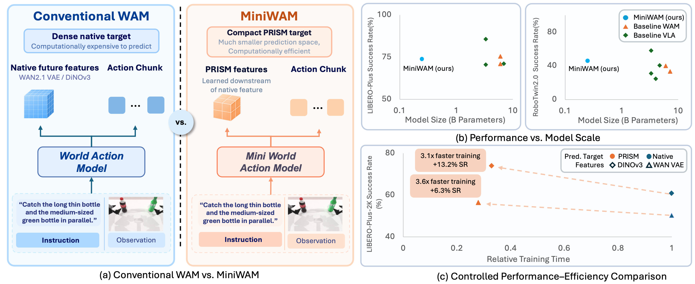
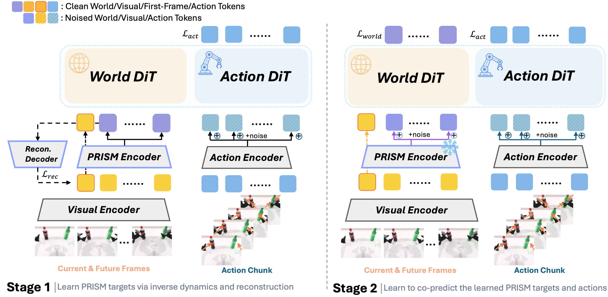

# MiniWAM

**MiniWAM: Learning Compact Future Targets for Efficient World-Action Modeling**

[](https://arxiv.org/abs/2610.12194)
[](https://j1dan.github.io/MiniWAM/)
[](https://huggingface.co/J1dan/MiniWAM)
[](https://github.com/J1dan/MiniWAM-release/actions/workflows/tests.yml)
[](LICENSE)



MiniWAM is a world-action model that, instead of predicting future video or
native visual features, predicts a compact future target, PRISM, alongside the
action chunk. Stage 1 learns the PRISM encoder from frozen DINOv3 features with
inverse dynamics and feature reconstruction. Stage 2 freezes the encoder and
trains a world expert and an action expert to jointly denoise PRISM tokens and
actions. Compared with predicting native features, it retains strong
performance while reducing training time.

## Install

Linux, Python 3.10 and an NVIDIA GPU with a CUDA 12 driver (525 or newer;
see [installation](docs/install.md)):

```bash
git clone https://github.com/J1dan/MiniWAM-release.git && cd MiniWAM-release
bash scripts/setup_miniwam_env.sh        # conda env "miniwam" and a pinned LIBERO checkout
conda activate miniwam
python scripts/verify_miniwam_environment.py --require-cuda --check-libero
```

DINOv3 ViT-B/16, the frozen visual encoder, is not redistributed with MiniWAM.
Request access on its
[Hugging Face page](https://huggingface.co/facebook/dinov3-vitb16-pretrain-lvd1689m)
(DINOv3 License), then download it once; the parallel evaluators run offline
and load it from the Hugging Face cache:

```bash
hf auth login
hf download facebook/dinov3-vitb16-pretrain-lvd1689m \
  --revision 5931719e67bbdb9737e363e781fb0c67687896bc
```

See [installation](docs/install.md) for the other model assets and the
benchmark environments.

## Results and checkpoints

| Checkpoint | Benchmark | Success rate |
| --- | --- | ---: |
| `libero` | LIBERO (4 suites × 10 tasks × 50 episodes) | 97.2% |
| `libero` | LIBERO-Plus (10,030 tasks) | 73.6% |
| `robotwin` | RoboTwin 2.0 (50 tasks × 100 episodes, clean and randomized) | 46.1% |

Both checkpoints are the 0.25B model on DINOv3 ViT-B/16 features (the count
excludes the frozen DINOv3 and UMT5 encoders). Download them into `checkpoints/`:

```bash
hf download J1dan/MiniWAM --include 'libero/*' 'robotwin/*' --local-dir checkpoints
```

Each checkpoint is a folder with `model.safetensors`, `config.yaml`,
`statistics.json` (action/proprioception normalization) and `metadata.json`.
The LIBERO folder also holds the instruction embeddings
`libero_instruction_features.pt`. With these, the LIBERO-Plus caches and the
frozen RoboTwin cases, evaluation does not need the 11 GB UMT5 encoder. Training
writes the same layout to `outputs/<run>/step_<N>/`.

## Evaluate

**LIBERO.** One task as a smoke test, then the full benchmark:

```bash
python scripts/eval/eval_libero_miniwam.py --checkpoint checkpoints/libero \
  --task_suite_name libero_10 --task_id 0 --num_trials 2 --output_dir eval_results/libero_smoke

python scripts/eval/run_libero_parallel_miniwam.py --checkpoint checkpoints/libero \
  --task_suite_names libero_10,libero_spatial,libero_object,libero_goal \
  --num_trials 50 --gpu_ids 0 --output_dir eval_results/libero
```

**LIBERO-Plus** uses the same checkpoint. Prepare once: set up the benchmark
([LIBERO-Plus evaluation](docs/evaluation.md#libero-plus)) and download the
instruction caches:

```bash
hf download J1dan/MiniWAM --include 'libero_plus_text_features/*' --local-dir datasets
```

Evaluate all 10,030 tasks:

```bash
python scripts/eval/run_libero_plus_parallel_miniwam.py --checkpoint checkpoints/libero \
  --text_feature_cache datasets/libero_plus_text_features/libero_plus_full_10030.pt \
  --gpu_ids 0 --output_dir eval_results/libero_plus
```

**RoboTwin 2.0** runs the simulator in its own environment and by default
replays frozen copies of the official evaluation cases. Prepare once:

```bash
bash scripts/setup_robotwin.sh                              # RoboTwin checkout and evaluator patch
bash scripts/setup_robotwin_eval_env.sh --download-assets   # simulator environment in .robotwin-env/
bash RoboTwin/XPolicyLab/policy/MiniWAM/install.sh miniwam
hf download J1dan/MiniWAM-RoboTwin-frozen-cases robotwin_eval_bundle_v3_unseen.tar \
  --repo-type dataset --local-dir datasets
tar -xf datasets/robotwin_eval_bundle_v3_unseen.tar -C datasets
```

Evaluate both conditions from the repository root, in the `miniwam` environment:

```bash
for split in demo_clean demo_randomized; do
  python RoboTwin/scripts/eval_policy_multitask.py --config configs/robotwin/eval_frozen.yaml \
    --policy-name MiniWAM --ckpt-name "$PWD/checkpoints/robotwin" \
    --env-cfg-type aloha_agilex --action-type joint \
    --policy-conda-env miniwam --eval-env-conda-env "$PWD/.robotwin-env" \
    --task-config "$split" --test-num 100 --seed 0 \
    --output-dir "$PWD/eval_results/robotwin/$split" --stream-output
done
```

Every launcher can spread its work over several GPUs, with several workers per
GPU: `--gpu_ids 0,1 --max_tasks_per_gpu 4` for LIBERO and LIBERO-Plus,
`--gpu-ids 0,1 --jobs-per-gpu 4` for RoboTwin (one value for all GPUs, or one
per GPU such as `8,4`). See [LIBERO and LIBERO-Plus evaluation](docs/evaluation.md)
and [RoboTwin 2.0](docs/robotwin.md) for protocols, resuming and the RoboTwin
summary.

## Train



Extract features first ([data preparation](docs/data.md)), then run the two
stages:

```bash
# LIBERO
python scripts/train.py --config configs/libero/stage1.yaml
python scripts/train.py --config configs/libero/stage2.yaml     # starts from outputs/libero_stage1/latest

# RoboTwin 2.0
python scripts/train.py --config configs/robotwin/stage1.yaml
python scripts/train.py --config configs/robotwin/stage2.yaml   # starts from outputs/robotwin_stage1/latest
```

The configs use a global batch of 256. On several GPUs, keep
GPUs × `--batch_size` × `--gradient_accumulation_steps` = 256, for example
`torchrun --nproc_per_node=4 scripts/train.py --fsdp --batch_size 64 ...`.
See [training](docs/training.md) for step counts and resuming.

## Ablations

Each ablation in the paper is a small config overlay stacked on the default
recipe, for example the 2×2 bottleneck with reconstruction only:

```bash
python scripts/train.py --config configs/libero/stage1.yaml \
  configs/ablations/capacity/grid2x2_d64.yaml configs/ablations/objective/recon_only.yaml
python scripts/train.py --config configs/libero/stage2.yaml \
  configs/ablations/capacity/grid2x2_d64.yaml configs/ablations/objective/recon_only.yaml
```

[configs/ablations](configs/ablations/README.md) maps every cell of Tables 1 and 4 to a command.

## Repository layout

```text
configs/        base.yaml, libero/, robotwin/, ablations/
miniwam/        model, native-feature baseline, dataset, checkpoints, RoboTwin runtime helpers
scripts/        train.py, data/ (feature extraction), eval/ (LIBERO, LIBERO-Plus, RoboTwin), setup
deploy/         RoboTwin policy runtime
integrations/   RoboTwin evaluator patch and XPolicyLab policy adapter
tests/          CPU tests: python -m pytest
```

## Citation

```bibtex
@article{chen2026miniwam,
  title   = {MiniWAM: Learning Compact Future Targets for Efficient World-Action Modeling},
  author  = {Chen, Jie and Bai, Ruofei and Cai, Yuxin and Zhang, Yifeng and He, Chengyang and
             Li, Jun and Yau, Wei-Yun and Sartoretti, Guillaume},
  journal = {arXiv preprint arXiv:2610.12194},
  year    = {2026}
}
```

## License

The code is released under the [MIT license](LICENSE). Parts are adapted from
other projects; see [third-party notices](THIRD_PARTY_NOTICES.md). Pretrained
encoders, datasets and simulators keep their own terms.
